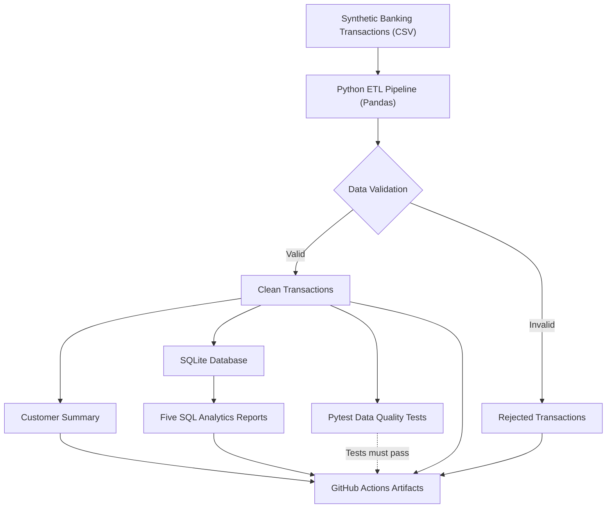

# Financial Data Platform — Architecture

This diagram represents the implemented banking-inspired data engineering workflow.

## Execution

GitHub Actions runs the ETL pipeline, SQL analytics, and automated tests before uploading the generated CSV files as downloadable artifacts.

All data is synthetic and intended for portfolio demonstration.
